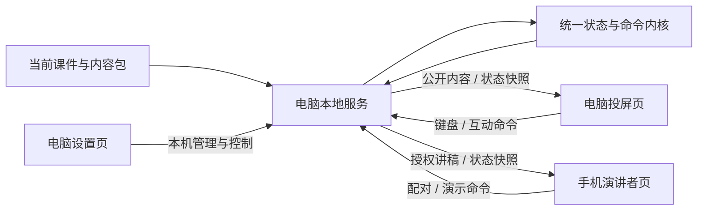

# 演讲与授课系统｜顶层开发文档

文档版本：1.1  
制定日期：2026-10-27（北京时间）  
当前软件版本：v0.2  
文档定位：统一产品目标、当前范围、系统边界、开发原则和验收依据。

> 2026-11-05 产品化规划入口。面向首版产品与试用，请读 [产品顶层文档](docs/产品化/01-产品顶层文档.md)、[开发计划](docs/产品化/02-开发计划.md) 和 [调研与证据](docs/产品化/03-调研与证据.md)。本文继续作为 v0.2 设计基线。

> v0.2 实施说明：用户最新明确指令已将 H07/H08 的标准内容平台部分转入开发。固定平台、内容包导入/库、SDK/沙箱、模板、init/validate/pack 工具已实现。实际接口见 [制作指南](03-标准内容包制作指南.md)，10 项自动化及两个标准包浏览器流程通过，真机缺口见 [STATUS](STATUS.md)。下文保留初版设计与决策过程，早期“尚未开发”对这些已实现能力不再适用。

> 本文是后续接手开发的首读入口。当前工作以已经实现的手机与 H5 双屏演讲系统为基础，继续完成稳定性与便携交付验收。内容生成、桌面应用、AI 眼镜、长课程与原生 PPT 适配仍在假设池，不因写入顶层设计而启动开发。

**2026-10-27 最新开发范围：用户已明确要求“根据你的思路进行开发”。本轮将 H07/H08 中的固定平台、标准内容包导入/校验、HTML 桥接、课件切换与内容制作模板纳入 v0.2 实施。以下早期“只作假设”的限制对这部分已被本次明确指令更新。AI 模型生成、桌面安装器、眼镜、原生 PPT 与多天授课仍保持假设状态。**

## 1. 产品目标与推进原则

### 1.1 当前要解决的问题

讲师在电脑向观众展示 H5 PPT，在手机查看当前页逐字稿、现场提示和下一页标题；手机与电脑均可操作演示，页码和渐进展开步骤保持一致。

核心使用闭环：

**电脑启动 → 选择课件 → 手机配对 → 电脑投屏、手机看稿 → 两端同步操作 → 结束会话。**

### 1.2 已确认的推进方式

先服务用户自己的真实演讲与授课，再根据实际使用和他人试用反馈判断推广价值。当前的成功标准是能稳定完成一场真实演讲，减少现场操作负担。

### 1.3 长期方向与当前承诺分开

长期可探索“资料制作—课件管理—排练—演讲—多端提词”的工作台。软件内 AI 生成和外部 AI 内容导入是用户表达的方向偏好。眼镜提词、几百页多天课程、原生 PPT 适配和对外产品化均待验证。

这些方向只定义可能的扩展位置与验证问题，不计入当前版本交付项。

## 2. 当前基线与证据

| 项目 | 已知事实 | 证据边界 |
|---|---|---|
| 当前课件 | 柴翔 Y 模型与 AI 长期竞争力，32 页 | 内容、配图、逐字稿、肖像、微信二维码来自交接包 |
| 复用样例 | 独立三页课件，含三阶段展开 | 证明同步内核与页数未绑定于当前 32 页；不代表已有通用课件编辑器 |
| 第一部手机 | Redmi K70 Pro + Android Edge | 用户确认逐字稿对应、手机控制 PPT、电脑翻页后手机跟随三项正常；系统/浏览器版本和网络方式未记录 |
| 第二部手机 | 小米 Mi 10 Pro + 系统浏览器 | 用户确认同一 Wi-Fi 下使用成功；浏览器具体版本未记录 |
| 自动化 | 10 项测试通过；浏览器验证原 32 页、两个标准包、恢复与互动 | 移动视口和同机 LAN 地址验证不替代真机 |
| Windows 交付 | 已有启动/停止脚本、自带运行时和便携 ZIP | 当前电脑启动、换目录解压、端口回退与进程复用通过；干净机器未验收 |

当前能力的详细状态、用户反馈和测试记录见 [STATUS.md](STATUS.md)。本文不把未测场景写成已通过。

## 3. 当前开发范围

### 3.1 必须保留的能力

| 领域 | 当前要求 |
|---|---|
| 设备关系 | 一台电脑、一场会话、一部主控手机 |
| 网络 | 电脑与手机处于可互通的局域网；同 Wi-Fi 已有真机反馈，手机热点待验证 |
| 电脑画面 | 保留当前 16:9 PPT、渐进动画、原有视觉、肖像、二维码与 Y 模型互动 |
| 手机画面 | 当前页讲稿、提示、下一页、字号、阅读位置、章节与演讲控制 |
| 命令 | 分步前进/回退、直接翻页、指定页跳转、重播、黑屏、总计时与练习计时 |
| 一致性 | 手机与电脑共用命令语义，统一服务端状态，讲稿与页面对应 |
| 连接 | 一次性配对、单主控、撤销与重新配对，失联后先同步再开放控制 |
| 备用 | 已加载的电脑窗口可以单机接管，另保留原始离线 HTML |
| 交付 | 使用现有便携方式启动和停止，不要求正常使用者执行开发命令 |

### 3.2 当前待完成的验收

Android Chrome、手机热点、手机锁屏/后台恢复、30 分钟共享计时、60 分钟连续运行，以及干净 Windows 环境。出现问题时围绕当前闭环修复，并保留已通过的两部手机验证结果。

### 3.3 只进入假设池的方向

内置资料/AI 生成、非标准资料解析与编辑器、统一桌面应用/安装器、对外产品化、AI 眼镜、语音跟稿、几百页多天课程、原生 PowerPoint/WPS 适配、公网和多人协作。符合 v1 标准的外部内容包导入属于 v0.2 已实现范围。

“便携版能正常交付”属于当前质量要求；“开发一个新的桌面工作台”属于封装假设。两者分别管理。

完整记录见 [产品假设池与能力边界](docs/HYPOTHESIS-POOL.md)。

## 4. 用户界面与操作边界

### 4.1 电脑设置页

负责课件选择、投屏入口、配对码、网卡地址、连接状态、撤销手机、计时与结束会话。管理操作限于本机入口。

### 4.2 电脑投屏页

向观众展示 PPT。正常演讲中不展示逐字稿、配对凭据和连接调试信息。电脑键盘、目录和课件互动继续可用。

### 4.3 手机演讲者页

以逐字稿阅读和单手操作为主。字体、滚动、阅读位置与自动滚动属于手机状态，不改变大屏布局，也不因读到末尾而翻页。

### 4.4 三个关键流程

1. **开始：**启动电脑服务，选对网卡，手机使用有效配对码进入，打开投屏页，确认当前页与讲稿一致。
2. **现场：**两端交替操作，优先执行分步命令；需要跳过展开时使用明确的直接翻页。黑屏和计时有明确状态。
3. **恢复与结束：**手机恢复前台后先同步；电脑单机接管后由操作者按 C 恢复遥控。结束会话后旧手机不能继续读取讲稿或发控制命令。

## 5. 系统架构

### 5.1 当前运行结构

### 5.2 模块职责

| 模块 | 职责 | 约束 |
|---|---|---|
| `core/` | 状态转换、页序、步骤、黑屏、计时、内容校验 | 不包含讲师姓名、固定页数、配对 UI 或特定传输实现 |
| `server/` | 会话、配对、权限、命令检查、SSE 快照与资源路由 | 作为联网状态的唯一顺序来源；只提供允许的项目资源 |
| `clients/host/` | 电脑设置与会话管理 | 不承担内容渲染和讲稿编辑 |
| `clients/display/` | 投屏、当前课件适配与单机接管 | 应用快照不能再次发送同一命令 |
| `clients/presenter/` | 手机讲稿、控制与阅读设置 | 私有阅读状态不驱动大屏翻页 |
| `decks/` 与课件适配 | 内容、主题、资源与课件专用组件 | 换课件不应改写同步内核；当前主课件仍通过基线构建接入 |
| `packaging/`、`runtime/` | 构建、启动、停止和现有便携交付 | 不依赖用户机器上的任意 Node 版本 |
| `verification/` | 可重复的核心与服务端验证 | 测试应覆盖实际风险，不能代替真实网络和设备记录 |

当前 Node HTTP 服务以 POST 接收命令，以 SSE 推送完整状态快照。首版不依赖云端、大模型 API 或 scrcpy。

### 5.3 保持扩展边界，不提前实现扩展

未来生成器若被选入开发，应产出可校验内容包；未来桌面应用若被选入开发，应调用现有会话与演示能力；未来眼镜若被选入开发，应作为新的私有提词端适配。当前仅保留这些模块边界。

当前主课件含专用渲染逻辑，通用三页样例仅支持有限页面内容。不能将当前结构描述为“任意课件换 JSON 即可自动完成设计”。

## 6. 内容、数据与接口原则

### 6.1 三类数据分开

| 数据 | 内容 | 访问与保存原则 |
|---|---|---|
| 公开课件 | 课件标识、版本、页面、展开步骤、可见素材 | 投屏端可读取，不夹带讲稿和现场提示 |
| 私有讲稿 | 按页面关联的段落、现场提示 | 仅授权演讲者与本机管理端可读取 |
| 演示/阅读状态 | 页面、步骤、黑屏、计时；手机字号和滚动 | 演示状态统一，阅读状态保留在手机；画布填写另行保存 |

### 6.2 内容标识

课件至少使用 `schemaVersion`、`deckId`、`revision`，页面使用 `slideId`，讲稿以页面标识关联。当前版本内的对应必须准确。

当前主课件的页面 ID 根据页序生成，跨修订增删或调序后的身份延续和阅读位置迁移尚未设计。因此当前不承诺跨版本自动迁移。未来涉及内容编辑或长课程时，需先解决稳定标识再扩展。

### 6.3 当前接口边界

| 能力 | 当前接口 | 规则 |
|---|---|---|
| 公开内容 | `/api/manifest` 与课件资源路由 | 不提供原始私有源码目录的任意访问 |
| 演示快照 | `/api/state`、`/api/events` | 手机与投屏依据相同演示状态更新 |
| 私有讲稿 | `/api/script` | 校验主控或本机权限 |
| 演示命令 | `/api/command` | 验证会话、版本、代次、ID、序号和时间 |
| 配对与管理 | `/api/pair`、本机 `/api/host*` | 初次配对与持续控制分开；撤销后旧凭据失效 |

以上是当前实现边界，具体请求字段以源码和相应实现设计为准。未来变更接口时同步更新调用方与验证记录。

## 7. 同步、故障恢复与数据边界

### 7.1 状态与命令

统一状态包含会话 ID、服务代次、状态版本、课件及修订版本、页面 ID、展开步骤、黑屏、演讲/练习计时和公开组件状态。

命令带客户端 ID、命令 ID、客户端序号、会话、服务代次、课件版本和发送时间。服务端去重并按顺序执行，拒绝不匹配、倒序与过期命令。当前超过五秒的命令会被拒绝。

`NEXT_STEP / PREV_STEP` 与 `NEXT_SLIDE / PREV_SLIDE` 分开；跳转按页面 ID 处理。电脑与手机必须进入相同命令路径。

### 7.2 连接中断

单个客户端最多一条待确认命令。断线不排队积压翻页，已发出但未收到确认的操作先通过快照核对，不能盲目重发。手机恢复后先同步，再允许新控制。

### 7.3 服务重启和单机接管

电脑窗口已加载时可继续单机操作。恢复连接后，由操作者按 C，以电脑当前画面重新建立遥控状态，避免被重启服务的初始页覆盖。

当前不提供所有窗口关闭、服务退出后的跨天持久会话。此类能力属于长课程假设，不能拿当前内存会话作为多天稳定性的证明。

### 7.4 资料与凭据

逐字稿、肖像、联系二维码和用户填写内容只按项目用途在本地使用。自动上传、公网部署、外部分享不由开发材料推导授权。

配对码短时一次性有效；持续控制使用独立凭据；电脑可撤销。Windows 启动与故障处理不自动修改防火墙或浏览器安全配置。

## 8. 规模、格式与产品能力边界

| 维度 | 当前边界 | 未来验证问题 |
|---|---|---|
| 页数 | 实测 32 页与三页样例，没有统一固定 32 页限制 | 几百页的目录、资源、讲稿加载和内存表现未测 |
| 时长 | 有计时与恢复机制 | 30/60 分钟仍待完成；多天授课另需课程组织与断点模型 |
| 文件格式 | 当前 H5 适配与内容样例 | 任意 PPTX/PDF/网页自动转换未实现 |
| 画面保真 | 保留当前确认的 H5 视觉 | 原生 PPT 动画、媒体、图表和字体不能直接承诺无损迁移 |
| 设备 | 两部 Android 手机已有成功反馈 | Chrome、iPhone、眼镜等均按各自证据标记 |
| 网络与会话 | 单场、单主控、局域网 | 手机热点待验收；公网、多主控和并发课程未实现 |
| 安装体验 | 便携目录与脚本入口 | 原生桌面工作台、安装器、自动更新仍为假设 |

长课程研究时，需分别比较保留原生 PPT、静态页面承载、原生 H5 重建与混合路线。迁移成本应计入内容补写、逐页核验、复杂页面修复和整课验收，不能只用导出速度估算。

没有真实样本和容量测试前，不给出统一每页成本、最大页数或连续运行时长承诺。

## 9. 质量要求与验收口径

### 9.1 证据分级

- **用户真机反馈：**记录设备、浏览器、网络和具体操作，版本未知时写未知。
- **开发环境浏览器：**记录入口、视口、交互和控制台情况，明确是否为模拟移动视口。
- **自动化：**验证命令、状态、边界与权限，可重复执行。
- **现场/时长：**按真实经过时间、真实设备与网络执行，不用改计时变量或同机模拟代替。

### 9.2 当前验收矩阵

| 验收项 | 通过条件 | 当前状态 |
|---|---|---|
| 基线完整 | 原内容、资源与确认视觉保留，源清单校验一致 | 已记录通过 |
| 同步与步骤 | 两端交替操作保持页面、步骤和讲稿一致，直接翻页语义明确 | 自动化与首轮真机基础反馈通过 |
| 命令可靠 | 连续 100 次命令、20 次交替无重复执行；拒绝旧会话/过期命令 | 自动化通过，真机完整次数测试未记录 |
| 讲稿隔离 | 未授权不能读取讲稿，撤销后原手机不能继续控制 | 自动化/同机浏览器通过，真机撤销待补 |
| 手机恢复 | 锁屏一分钟期间电脑继续翻页，解锁后对齐最新状态 | 待真机验收 |
| 网络恢复 | 断开十秒后读最新状态，不补发旧点击 | 同机浏览器通过，真机待补 |
| 共享计时 | 真正运行三十分钟，两端显示差异不超过一秒 | 待验收 |
| 连续运行 | 真正运行六十分钟，页码、计时与连接无未解释异常 | 待验收 |
| 网络/浏览器 | 手机热点和 Android Chrome 实际完成闭环 | 待验收 |
| 便携交付 | 干净 Windows 按说明启动、配对、演讲并结束，不要求安装 Node | 当前电脑搬迁通过，干净环境待验收 |

稳定可互通局域网下，操作到画面变化的 P95 不超过 300ms 是原设计目标，尚不是实测性能结论。

### 9.3 交付所需材料

可运行文件、明确启动/停止入口、使用说明、测试记录、已知限制、当前状态与下一步。只有开发脚本能运行，不足以代替正常使用验收。

## 10. 当前推进阶段

| 阶段 | 工作内容 | 完成依据 |
|---|---|---|
| A 已有基础 | 基线、配对、同步内核、手机讲稿与复用样例 | 现有代码、自动化记录和两部手机反馈 |
| D v0.2 平台化 | 内容包/库、SDK、模板、制作工具已实现 | 10 项自动化与两个标准包浏览器流程；真机复验待完成 |
| B 下一步质量工作 | 补 Chrome、热点、锁屏、真机断网、计时与连续运行，修复发现的问题 | 第 9 节验收证据补齐；没有设备时保留缺口 |
| C 当前便携交付验收 | 干净 Windows 验证当前启动方式、说明、端口回退和退出 | 在实际目标环境可独立完成完整流程 |
| H 假设池 | 生成器、桌面工作台、眼镜、长课程、原生 PPT、对外产品化等 | 当前只记录，未进入开发 |

阶段 B/C 是当前系统的验证与修复范围，不自动扩展为新业务功能。本文不指定未经验证的工期。

## 11. 假设进入开发的规则

新增设想先写入假设池，保留用户原意、收益、未知、成本与最小验证方法。

以后若要转为开发，至少明确：用户/场景、输入和输出、采用路线、当前不覆盖的情况、数据影响、验收方式，以及用户明确选定的实施范围。随后更新本文范围、相应实施方案与 STATUS；依赖新模型、外部服务或指定硬件时，另记接入条件。

讨论价值、查询官方文档、写概念方案或在架构图留接口，均不等于假设已经成为必须交付的功能。用户直接调整范围时，以最新明确指令更新文档，不增加重复确认环节。

## 12. 开发与文档协作规则

### 12.1 开发规则

1. 先读本文与 STATUS，识别当前阶段；不重复从 M0 初始化。
2. 保留 `baseline/` 作为来源对照，新代码进入各自模块。
3. 保持用户确认的文案、讲师资料、图片、二维码与视觉；内容变更与系统功能分别记录。
4. 按实际变更选择构建、测试和浏览器验证；不为纯文档改动重复跑完整功能测试。
5. 不将失败、未测或模拟验证记为真机成功；修复后复测相关路径。
6. 需要真实手机、特定网络或干净环境时，先完成可独立开展的工作，并明确剩余验收条件。

### 12.2 文档职责

| 文档 | 职责 |
|---|---|
| 本文 `00-顶层开发文档.md` | 产品目标、当前范围、架构边界、质量标准与变更规则 |
| `STATUS.md` | 当前实现、用户反馈、验证证据、已知缺口和下一步 |
| `DESIGN.md` | 手机与 H5 双屏模块的细化设计和历史依据 |
| `PLAN.md` | 原 M0–M6 计划与实施演进；按 STATUS 区分已完成和待验收 |
| `IMPLEMENT.md` | 接手开发的简短执行入口 |
| `docs/HYPOTHESIS-POOL.md` | 尚未进入开发的设想、成本、边界与未来验证办法 |
| `README.md` | 用户运行、恢复、备用与开发命令 |
| `01-开发复盘与复用手册.md` | 本次过程、故障经验、可复用开发技能与工程模板的抽离边界 |
| `02-平台与内容包标准草案.md` | 固定平台与可替换内容包、HTML 适配、内容生成与校验的历史架构草案；实际标准见制作指南 |

用户最新明确指令决定范围；本文维持整体一致；实现状态与事实以 STATUS 的具体证据为准。早期“从零开始”的指令作为历史保留，不覆盖当前阶段。发现文档冲突先核对最新指令和证据，再同步修正文档。

### 12.3 后续接手任务的默认落点

当用户仅要求继续当前开发时，从 v0.2 真机复验与阶段 B/C 的未完成验收、相关问题修复着手。其余假设只有在用户明确选择后，才制定具体实施任务。

## 13. 初版决策记录（历史，最新状态见文首与 STATUS）

- 顶层入口统一为本文件，文档版本 1.0 与软件版本 v0.1 分开标识。
- 以现有双屏演讲闭环为当前产品范围，先完成可验证的稳定与交付质量。
- 保留演示内核、内容、终端、连接与交付层的分工。
- 维持个人先用、反馈后判断推广的方向，不预设商业化需求已经成立。
- 内容生成双入口、桌面封装、AI 眼镜、几百页多天课程与原生 PPT 适配全部保持假设状态。
- 本轮仅整理开发文档和入口关系，不改变服务、课件或手机会话。

### 开发经验复用补充（2026-10-27）

按用户要求，将过程与复用方法记录为 [开发复盘与复用手册](01-开发复盘与复用手册.md)，并封成 `h5-phone-presenter` Codex 技能与匿名三页数据样例。这是开发方法沉淀，不扩展当前应用功能。通用可执行工程母版和项目初始化器列入 H07，尚未提取；产品桌面封装仍属于 H02。

用户进一步提出“固定功能平台 + 可替换 HTML 互动课件与备注”，整理为 [平台与内容包标准草案](02-平台与内容包标准草案.md)，对应 H08。平台程序与每套内容包分成两个交付单元，生成与导入遵守同一标准；当前没有启动重构或新增导入功能。

交付形态补充：用户要求集中交付，当前可运行程序、文档和复用技能合并到一个完整 ZIP，顶层提供启动/停止入口；内部按用途组织。此为现有便携交付整理，不等同于实现桌面安装器或新平台。

### v0.2 实际内容标准

内容制作从模板初始化，修改清单/H5/独立讲稿，校验并打包 .h5deck，再由工作台导入。包库与当前选择落盘，演讲会话仍按已有恢复规则处理。内容运行在受限 iframe 并通过 SDK 接统一命令，不取得私有稿件和管理凭据。制作接口详见 [03-标准内容包制作指南](03-标准内容包制作指南.md)。
