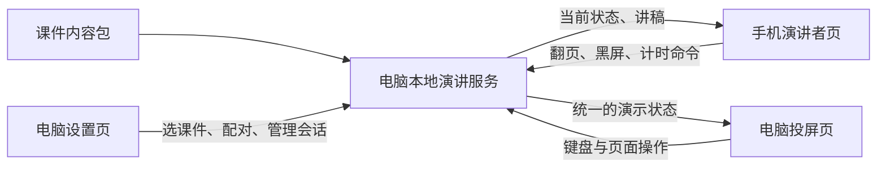

# 手机遥控与双屏演讲系统：顶层设计

文档角色调整（2026-10-27）：整体开发基准见 [00-顶层开发文档.md](00-顶层开发文档.md)。本文保留为双屏模块的细化设计与历史依据；实际完成情况以 STATUS.md 为准，未实现的设计不自动进入当前范围。

版本：v0.1  
日期：2026-10-26（北京时间）  
状态：基础双屏 v0.1 已实现；本文记录设计依据，实施补充见文末，验收情况见 STATUS.md。  
首个接入案例：柴翔《如何用 Y 模型构建 AI 时代下的长期竞争力》

## 1. 先定下的五个决定

1. 首版面向“一台电脑、一部主控手机、一场演讲”，使用可互通的同一局域网或热点，不依赖云服务。
2. 电脑投屏页只展示幻灯片。手机展示当前页逐字稿、提示、下一页标题与控制按钮。
3. 同步“页码和渐进步骤”，不能只同步整页。电脑键盘、手机按钮共用同一套操作规则。
4. 演示能力、课件内容、连接方式分别组织。先接入现有32页课件，再用第二套小课件验证复用。
5. 正常使用入口为“一键启动、扫码配对”。现有离线单文件保留为单机备用。

顶层设计不是为了增加审批环节，而是为开发提供共同依据：做什么、怎样复用、怎样判断做成了。

## 2. 用户实际怎样使用

### 演讲前

1. 在电脑双击启动程序，选择课件。
2. 电脑打开演讲者设置页，显示可连接的网络地址、配对二维码和连接状态。
3. 手机连到与电脑可互通的网络，扫描配对二维码，用系统浏览器打开。
4. 完成配对，手机显示当前页讲稿；电脑设置页显示“手机已连接”。
5. 打开电脑投屏窗口，进入全屏，再开始正式演讲。

手机配对二维码与结束页微信二维码是两种用途。配对二维码放在演讲者设置中；结束页微信二维码继续用于听众联系柴翔。

### 演讲中

- 手机点击“下一步”：电脑先展开当前页下一段内容，全部展开后再翻页；手机同步切换到对应讲稿。
- 手机点击“上一页”：执行现有演示器的回退规则，按钮命名应明确区分“上一步”和“直接上一页”。
- 电脑用键盘翻页：手机页码、讲稿与下一页标题同步更新。
- 手机滚动或调大讲稿字体：只改变手机阅读界面，不影响电脑幻灯片。
- 手机支持章节跳转、黑屏和计时控制。
- 网络短暂断开：电脑保留画面；手机显示连接状态，恢复后读取电脑当前进度。

### 演讲结束

停止计时、关闭遥控会话。手机控制凭据失效；课件内容和本机练习画布按各自的保存规则保留。

## 3. 首版范围

| 进入首版 | 后续独立扩展 |
|---|---|
| 同网络扫码配对 | 公网跨网络连接 |
| 一部主控手机 | 多主持人同时控制 |
| 当前页讲稿、提示、下一页标题 | 语音识别自动跟稿 |
| 字号调整、手动滚动 | AI临场生成提示 |
| 分步前进、回退、直接翻页、章节跳转 | 原生PowerPoint遥控 |
| 黑屏、总计时、连接状态 | 课程销售、学员账户和支付 |
| 断线恢复、重复命令防护 | 手机远程编辑全部复杂画布 |
| 当前32页课件接入 | 任意第三方HTML免适配导入 |

首版的自动滚动可作为可关闭的附加功能：手动滚动立即暂停自动滚动，速度由讲师控制，不依赖语音识别，也不以滚动到末尾触发翻页。

## 4. 三个界面

### A. 电脑投屏页

保留当前16:9、关键词、配图、动画和互动模型的视觉。
正式演示时不显示逐字稿、配对二维码、调试信息或手机连接提示。
网络状态放在演讲者端；黑屏和键盘操作仍能从电脑发起。

### B. 手机演讲者页

顶部：课件名、页码、当前页标题、简洁连接状态。  
中部：当前页讲稿，独立展示现场提示。  
底部：大尺寸“上一步 / 下一步”，以及可展开的章节、计时和黑屏控制。  
辅助：下一页标题、字体大小、手动/自动滚动切换。

阅读位置按“课件版本、页面ID、段落ID”记录。翻到新页面定位到该页开头，回到已读页面可恢复阅读位置。仅同步页面状态，不把手机滚动反向映射为电脑翻页。

手机不必下载16MB的全部投屏背景图。首版可只读取文字、页码和必要状态。

### C. 电脑演讲者设置页

负责启动、选择课件、配对、重新配对、结束会话，以及连接问题提示。
与投屏窗口分开，准备阶段完成配对。演讲者能在电脑撤销手机控制权。
提供可复制的连接地址作为扫码失败时的备用入口。

## 5. 总体结构



本地服务提供页面、内容接口、会话管理和实时同步。建议使用Node.js与同源实时连接；实施时锁定维护中的LTS版本及依赖版本。第一轮先验证实际设备连接，再决定最终打包方式。

所有设备从本地服务提供的地址进入，避免以“公共网站连接电脑上的 file:// 文件”作为主路径。浏览器对本地网络访问有额外限制，需要在真实浏览器版本上验证。[Chrome官方说明](https://developer.chrome.com/blog/local-network-access)

## 6. 真正要复用的四层

| 层 | 职责 | 换课件时是否更改 |
|---|---|---|
| 演示核心 | 页序、分步、计时、黑屏、状态通知 | 通常不改 |
| 内容包 | 页面内容、讲稿、图片、主题、讲师资料 | 更换这一层 |
| 手机与电脑界面 | 阅读、控制、投屏、配对 | 通常不改 |
| 连接服务 | 会话、命令、状态、重连 | 通常不改 |

柴翔的姓名、照片、微信二维码、Y模型字段、60分钟目标、32页数量，都属于当前内容包，不能写死在通用遥控系统里。

### 内容包的建议结构

```text
decks/
  chaixiang-ai-y/
    manifest.json          页面顺序、ID、主题和渲染信息
    script.json            逐页讲稿、提示与建议时长
    speaker.json           姓名、身份、照片、联系二维码
    assets/                配图、背景和照片
    widgets/               该课件需要的Y模型等组件
```

后续新课可以新增一个目录；复用演示核心和手机端。内容包应能检查缺图、重复页面ID、漏配讲稿等问题。

### 复用边界

- 使用标准内容包和已有页面类型：可以更换内容与主题直接复用。
- 自己制作的其他HTML：接入统一适配接口后复用；复杂互动需要提供状态保存与恢复方法。
- 任意网络HTML、跨域网页：不能承诺直接拖入即用。
- 原生PPTX：需要另做PowerPoint接口或系统控制适配，当前设计不等于已经支持。
- 公网版本：可沿用内容格式和控制协议，但需要另设计部署、鉴权和内容上传流程。

## 7. 内容、讲稿与演示状态

### 内容必须使用稳定ID

页面用 `slideId` 关联讲稿，不只依赖“第几页”。调整页序后，讲稿仍能对应正确页面。

每套课件包含：

- `schemaVersion`：内容格式版本。
- `deckId`：课件标识。
- `revision`：本次内容修订版本。
- 每页 `id`、`kind`、公开内容、分步数量和建议时长。
- 对应页面的讲稿正文、段落ID和现场提示。

当前已有备注稿可作为首版讲稿来源。若补充更完整的逐字稿，应替换内容层，不重写遥控逻辑。建议时长是编排数据，不能当成实讲已达标的证据。

### 公开内容与讲稿分离

标准双屏模式中，投屏端请求公开页面内容，手机凭演讲者权限请求讲稿。现有单文件HTML包含备注，是备用导出格式；不能把“界面隐藏备注”等同于“文件中不存在备注”。

### 同步状态

```text
PresentationState
  sessionId
  serverEpoch
  stateVersion
  deckId + deckRevision
  slideId
  revealStep
  blackout
  presentationTimer
  exerciseTimer
  publicWidgetState
```

投屏中的“课程/内容”切换、六类场景选择等属于公开组件状态。手机阅读字号与滚动位置属于手机本地状态。Y模型填写数据独立保存，不因翻页而清空。

### 通用适配接口

```text
getManifest()             读取公开页面结构
getState()                读取当前演示状态
dispatch(command)         执行统一命令
applySnapshot(state)      恢复指定状态，不产生第二次控制命令
subscribe(listener)       通知状态变化
```

远程入口不依赖点击具体DOM按钮。电脑键盘、手机按钮与章节跳转，都调用同一命令入口，避免形成两套翻页规则。

## 8. 同步与重连规则

### 谁决定当前进度

连接正常时，本地服务维护唯一的有序状态。电脑和手机发送命令，服务执行后推送确认状态。不能让两边各自独立计算页码，再尝试互相覆盖。

命令至少带有会话ID、客户端ID、命令ID、客户端序号和动作。服务使用命令ID去重；旧会话、过期命令或不匹配的课件版本不执行。

### 前进与后退

沿用当前语义：

- NEXT_STEP：优先展开当前页，再进入下一页。
- PREV_STEP：优先收回当前页一步，再返回上一页。
- NEXT_SLIDE / PREV_SLIDE：直接翻页。
- GOTO_SLIDE：按页面ID跳转。
- SET_BLACKOUT：设置黑屏状态。
- TIMER_START / PAUSE / RESET：统一计时。
- WIDGET_ACTION：执行已注册的组件动作。

手机可显示“下一步”而不是含义不清的“下一页”。

### 防止重复和迟到命令

每个控制端限制待确认命令数量，连接正常时按顺序处理快速点击；断线时不缓存翻页动作。恢复后先拉取完整状态，再允许继续控制，避免积压的旧点击让课件突然跳过数页。

### 三种恢复场景

| 场景 | 预期行为 |
|---|---|
| 手机锁屏或切到后台 | 电脑继续演示；手机回到前台后读取最新页码、步骤和讲稿 |
| 网络中断后恢复 | 手机显示重连，旧命令丢弃，恢复后对齐当前状态 |
| 本地服务重启 | 服务代次变化；电脑进入明确的单机接管，恢复遥控前以电脑当前画面重新建立会话 |

如果进入单机接管，不自动重放中断前的手机命令。原单文件HTML仍是额外备用，不能把备用文件与实时会话混作两套同时控制的来源。

计时采用统一基准；手机后台暂停不应让全场计时归零。手机显示秒数允许轻微刷新差异，但重新连接后必须校正。

WebSocket可承载双向状态同步；协议与UI分离，便于后续替换传输实现。[MDN机制说明](https://developer.mozilla.org/en-US/docs/Web/API/WebSockets_API)

## 9. 配对与现场连接

- 每场会话生成新的配对凭据，只允许一个主控手机。
- 初次配对凭据短时、一次性有效；成功后换取会话控制凭据。
- 电脑能撤销控制权并重新配对。
- 配对链接不直接暴露完整讲稿和个人资料目录。
- 服务只提供允许的课件资源，不提供任意本地文件读取。
- 首版不自动改变系统防火墙、浏览器安全设置或外网端口映射。

“同一个Wi-Fi”不一定代表设备可互通。启动页要能提示选错网卡、设备隔离或连接超时，并提供更换网络地址的办法。VPN与虚拟网卡不应被自动当作唯一正确地址。

微信可用于扫码，但首版正式测试以手机系统浏览器为主，内置浏览器另行记录兼容情况。

常亮只能作为增强能力，不能成为连接可用的前提。浏览器的Screen Wake Lock有安全上下文和页面可见性限制；不支持或被系统释放时，应提供可理解的提示，恢复前台后再尝试申请。[MDN常亮机制](https://developer.mozilla.org/en-US/docs/Web/API/Screen_Wake_Lock_API)

## 10. 从当前课件迁移

| 当前已有 | 接入方式 |
|---|---|
| `CHAPTERS / SLIDES`，位于现有 content.js | 导出标准清单与独立讲稿 |
| `go / next / prev / updateReveal` | 收敛为统一命令入口 |
| `render` 与页面类型渲染 | 保留视觉，增加状态快照应用接口 |
| 总计时与练习计时 | 改用可序列化、可恢复的计时状态 |
| 课程/内容、场景、成长阶段切换 | 注册公开组件状态 |
| Y模型编辑与本机保存 | 保留独立数据，按课件ID命名空间保存 |
| 照片、二维码和背景常量 | 移到讲师资料与资源配置 |
| 单文件构建脚本 | 增加双屏内容包输出，保留单文件输出 |

先接通状态和命令，再分离内容与UI。避免同时大规模改视觉、重写内容和重做遥控，导致无法判断回归问题来自哪里。

建议迁移后的开发目录：

```text
presenter-system/
  docs/                   顶层设计、接口与验收记录
  core/                   演示状态、命令和计时
  clients/display/        电脑投屏
  clients/presenter/      手机与桌面演讲者界面
  server/                 本地服务、会话和资源接口
  adapters/               当前课件及其他HTML适配
  decks/                  课件内容包
  packaging/              一键启动与离线构建
  verification/           同步与恢复场景验证
```

这是一份计划目录，尚未创建或实现。

## 11. 开发顺序与验收

| 阶段 | 交付 | 通过条件 |
|---|---|---|
| M0 实际连接验证 | 一键启动原型、扫码配对 | 在用户实际手机与电脑上完成配对、断开与重连，记录系统和浏览器版本 |
| M1 同步内核 | 统一状态与当前课件适配 | 手机和电脑都能控制页码与渐进步骤，另一端立即跟随 |
| M2 手机讲稿 | 阅读与控制界面 | 对应讲稿、字号、阅读位置、下一页标题可用，电脑不显示手机UI |
| M3 现场可靠性 | 计时、重连、单机接管 | 锁屏、网络中断、重复点击和刷新后不误翻页、不丢失当前进度 |
| M4 复用与交付 | 第二套测试课件、一键启动包、说明 | 更换内容包无需修改遥控核心；干净Windows环境可按说明启动 |

“干净Windows环境”是否需要安装Node必须在交付时明确。目标交付包应附带所需运行环境，正常使用不要求讲师手动执行开发命令。开发脚本能启动不等于已完成便携交付。

### 必须验证的场景

1. 当前32页全部可投屏，原有内容、照片、二维码与Y模型保留。
2. 手机连续控制100次操作，命令按确认结果执行，无重复或漏执行。
3. 电脑键盘与手机交替操作20次，讲稿与动画步骤一致。
4. 手机锁屏一分钟期间，电脑翻页；恢复后手机显示最新页面。
5. 网络中断十秒后恢复，旧点击不补发；能重新同步。
6. 计时运行三十分钟后两端差异不超过一秒，刷新手机不归零。
7. 讲稿换行和字号变化不影响投屏比例，手机无横向滚动。
8. 遥控凭据失效后不能继续控制，重新配对可正常使用。
9. 同一内容包缺讲稿、重复页面ID或版本不一致时，有明确提示。
10. 第二套三页测试课件可替换讲师资料、主题和讲稿，遥控核心不改代码。
11. iPhone Safari、Android Chrome和电脑Chrome/Edge记录实测版本；未测设备明确标记，不能用模拟手机视口代替全部真机验收。
12. 浏览器拒绝全屏或常亮时，仍能完成演示与手动控制。

验收目标中的操作延迟：在可互通、信号稳定的局域网条件下，手机动作到投屏变化的P95目标不超过300毫秒。属于待测目标，不是当前性能承诺。

## 12. 未来怎样复用

### 下一场演讲

复制内容包，替换标题、逐字稿、图片和讲师资料，继续使用扫码、控制、计时与重连。新增页面样式时增加渲染组件，避免直接改手机遥控页。

### 同一课程的30/45/60分钟版本

复用同一套稳定页面ID，用不同播放清单安排页序与选讲页；讲稿可以带不同长度版本。是否真正讲满对应时长，仍要排练验证。

### 讲师自己的长期工具

逐步增加演讲记录、分页实际耗时、讲稿版本、字体偏好和多课件管理。先验证几次真实演讲中的使用习惯，再决定是否增加复杂管理功能。

### 云端与原生PPT

云端连接、多人协作、原生PowerPoint接入都作为独立适配扩展。复用核心协议与内容格式，不把“将来可扩展”写成“首版已经具备”。

## 13. 实施前需要记录的信息

- 实际使用的手机系统、浏览器和电脑投屏方式。
- 常用网络是会场Wi-Fi、电脑热点还是其他连接。
- 手机主要手持、放讲台还是配合独立遥控器。
- 逐字稿使用现有逐页备注，还是后续补充完整版本。

这些信息用于M0真机验证与界面细节，不阻止先按本设计搭建核心。

## 2026-10-27 实施补充

v0.1 使用 Node HTTP + POST 命令 + SSE 完整快照落实同源实时连接，传输层可替换，命令与内核独立。服务端检查服务代次、会话、版本、命令 ID 与客户端序号，超过五秒的命令拒绝；客户端最多一条待确认命令，断线不排队。

手机以 URL 片段内的一次性凭据换取 HttpOnly / SameSite cookie，凭据两分钟失效；电脑管理限于回环地址。公开投屏数据不含讲稿或现场提示。大屏隐藏控制栏与同屏备注入口，保留键盘、目录与原互动。

Windows 入口使用附带 Node 24.22.1。电脑断线后可按键单机接管，恢复时按 C 显式采用当前画面，不自动覆盖为重启服务的第一页。验收状态见 STATUS.md。

