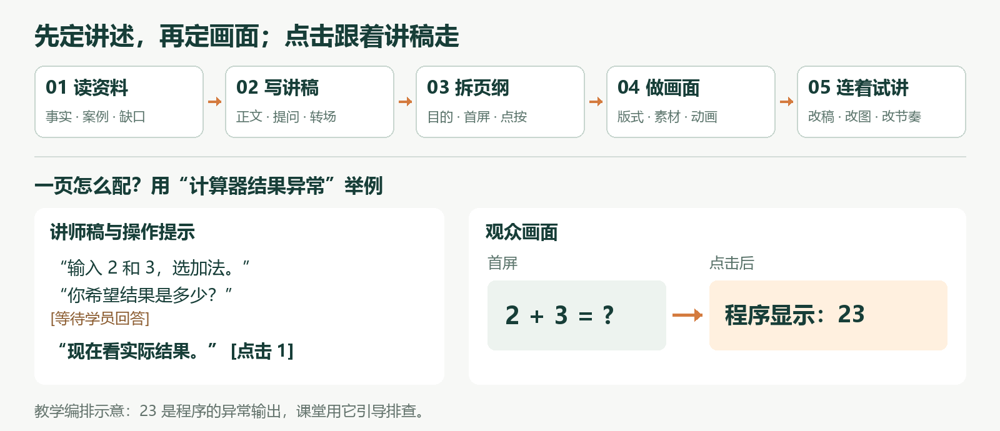

# 把资料变成能讲的课：用 AI 配好逐字稿、课件和动画

我的实践是：先确认讲师要说什么，再决定观众看什么、讲到哪里点一下。本教程以项目里的计算器调试教学为例，带你做三页样段。文末附件含原始材料、完整提示词、设计表示例和双屏运行环境。

**开始前：**下载附件并完整解压。在 WorkBuddy 等本地 AI 编程助手中，把解压后的整个练习包设为工作目录。打开 `AI制课练习/制作要求.md`：填写听众、时长、学完能做什么、讲稿能否改写。示例已填好，可先照做一遍。

**第一步｜让 AI 读资料，先确定这段课教什么。**

复制给 AI：“读取 `AI制课练习` 中的要求和资料。列出可用事实、案例、缺口及所在文件；围绕‘学员能交一份可复现的调试记录’安排讲述顺序。资料没写的标待补，先输出内容方案。”

**你检查：**每个关键结论能找到依据；内容服务于一个可完成的任务。原始材料里的“2+3 显示 23”是待排查现象，不能写成正确计算结果。

**第二步｜先写能直接讲的逐字稿。**

复制：“按内容方案写可直接朗读的讲师稿，保留案例、操作、提问和转场；把讲者正文与等待、演示提示分开。分别安排讲解和练习时间，保存为 `产出/讲师稿.md`。”

**你检查：**读一遍，看是否像自己会说的话。案例要能跟着做，结尾要说清学员交什么。若输入的是已定稿发言，明确要求保留原文，只做分页和提示。

**第三步｜从讲稿拆页面，把动画写成操作。**

复制：“依据我确认的讲师稿，先出三页设计表，字段为：页 ID、讲述目的、对应稿段、首屏内容、点按后出现什么、点击对应哪句话、页型与素材。保存为 `产出/逐页设计表.md`，暂不做全套课件。”

**示例：**原始资料是“输入 2 和 3，程序显示 23”；讲师说“你希望结果是多少？”时，屏幕只放输入和问号。等学员回答，讲到“现在看实际结果”再点击，让“程序显示：23”出现。讲稿里的这句话与点按动作配对，答案不会提前露出。

**第四步｜先做三页画面，再检查呈现。**

复制：“按已确认的设计表，用 `app/content-templates/basic` 制作三页 H5。问题页突出输入与结果，方法页画操作顺序，练习页写任务和提交物。统一字体与配色，点按用淡入或连线，等待时保持画面。保留平台 SDK，完整稿放私有备注；校验并打包为 `app/my-course.h5deck`。完整实现指令见 `AI制课练习/分步提示词.md`。”

**你检查：**一眼能抓到当前重点；字号在实际投屏中可读；动画帮助讲解；回退后仍能重新按顺序展开。

**第五步｜连着讲一遍，再扩展。**

双击附件里的“启动双屏演讲.cmd”→“导入内容包”选择 `app/my-course.h5deck`→在“当前课件”选择新课→打开投屏。手机和电脑连可互通的 Wi-Fi，选择对应网卡、重新扫码，用手机看稿试讲。

记录三处反馈：哪句话念着不顺、哪张画面看不清、哪次点击跟不上。把具体位置交给 AI 修改，三页通过后再逐段扩展。总时长以实际试讲为准，讲解、操作和练习分别计时。

**最后应拿到：**可直接讲的逐字稿、逐页设计与点按表、能运行的课件和对应备注。普通演示无需 AI 在线；AI 用于制作与修改。本案例输出 H5 课件，原生 PPTX 需另行制作或适配。
