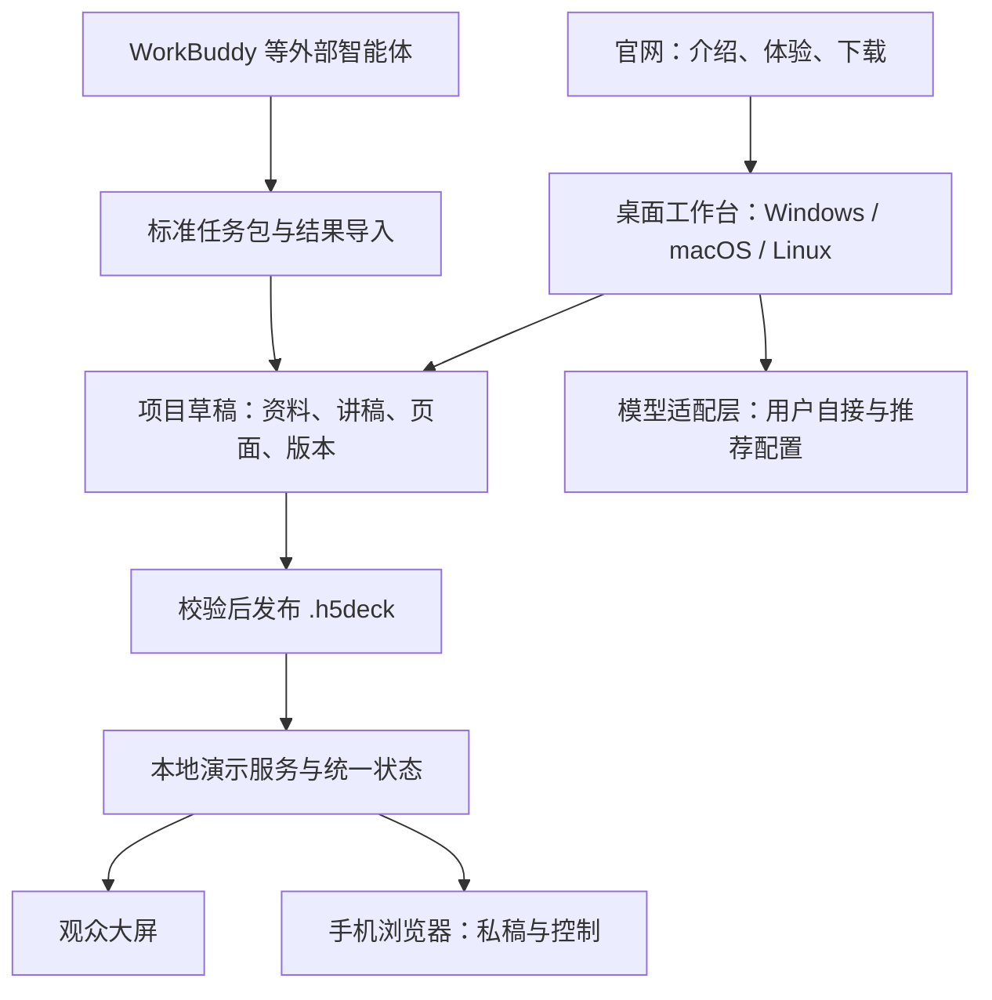

# 开场有光｜产品与上线总计划

2026-11-06 · 规划稿 v1 · 软件基线 v0.2.0

这份计划落实本轮已确认的方向。它描述下一阶段的产品，不代表所列功能已经上线。当前可用能力以源码的 STATUS 为准。

配套：[实施与验收](02-实施清单与验收标准.md) · [品牌与官网](03-品牌与宣传页方案.md) · [模型接口与推荐机制](04-模型接口与推荐机制.md)

## 1. 已确认的产品方向

| 决策 | 本轮结论 | 对实施的影响 |
| --- | --- | --- |
| 主品牌 | **开场有光** | 官网、软件入口、安装包展示名统一；内部 H5Deck 标识保留兼容 |
| 备选品牌 | **一页开讲** | 作为独立备选留档，不与主品牌同时对外传播 |
| 产品形态 | 桌面软件优先，覆盖 Windows、macOS、Linux | 官网承担介绍、体验和下载；手机用浏览器配合演讲 |
| AI 路径 | 内置 AI 制作，同时兼容 WorkBuddy 等外部智能体 | 两条路径共用内容结构、编辑器、校验和发布流程 |
| 模型接入 | 提供可扩展接口，用户能自行配置不同模型 | 模型选择独立于内容库；服务地址、模型、凭据可配置，按任务推荐 |
| 核心结果 | 根据资料生成高质量课件与配套逐字稿 | 把资料依据、口语稿、页面结构、动画、排练串成闭环 |

这一方向更新了旧产品文档中的 Windows 优先范围和便携交付建议。已经交付的 v0.2.0 保留原有能力与支持说明。

## 2. 名字怎么成为产品

**完整名称：开场有光。品类说明：AI 课件与演讲工作台。**

主张：**把你的资料，做成能讲的内容。**

品牌句：**把准备留在幕后，让表达走到台前。**

“开场”让人联想到真实的讲课、汇报和上台时刻；“有光”对应准备充分、思路清楚、呈现出彩。产品必须让人看见这份变化：原始资料变成清晰结构，长稿变成可讲段落，页面随着讲述展开，手机把下一句放在手边。

正式对外使用四字全名，首次出现配品类说明，减少被误解为灯光设备或表达培训的可能。视觉中的光来自舞台开口、页面留白和内容聚焦；软件日常编辑界面以可读性为先。

名称选择参考了用户提供的[科学起名课程](https://tongdao-yitang.feishu.cn/wiki/FUY4wGuiziLolYkuqhncZs3gnid)：先明确用户与场景，再扩充名字、评估传播与意义、做使用验证。前轮 87 分是项目内部设计评分，不能代表用户测试或商标可用性。公开宣传前需核实相关类别名称、域名与账号；目前尚未完成这些核验。

## 3. 产品为谁解决什么

首批服务有真实资料、需要反复上台的人：独立讲师、企业内训师、做方案汇报和产品演示的专业人士。先把项目负责人现有课程跑顺，再邀请不同主题的讲师试用。

| 用户带来的东西 | 现在容易卡住的地方 | 开场有光应交付什么 |
| --- | --- | --- |
| 业务资料、Markdown、旧讲稿 | 信息多，难形成讲述顺序 | 有依据的结构、能说出口的完整稿和待补信息清单 |
| 已定稿逐字稿 | 拆页后原文丢失，页稿对不上 | 原文留存、逐页映射、可锁定的人工内容 |
| 旧 PPTX | 有画面，缺可用备注；改成 H5 要重做 | 可检查的迁移结果、逐页备注、复杂对象处理提示 |
| 做好的课件 | 只看静态截图无法判断讲述节奏 | 真正可点击的预览、按稿展开和试讲修订 |
| 一场即将开始的演讲 | 要找稿、切窗口、处理手机连接 | 干净大屏、私有手机稿、清楚的连接状态和电脑接管 |

完整体验：**导入资料 → 确定听众与目标 → 打磨逐字稿 → 安排页面与动画 → 三页试讲 → 完整发布 → 手机配对演讲 → 交付与复用。**

首个正式产品版本必须同时跑通制作和演示。离线编辑、查看和演讲可独立使用；云模型生成需要可用的服务账号和网络，本地模型按用户设备能力工作。

## 4. 现有基础与需要新增的部分

本轮在包内 Node 24.22.1 上重新构建并运行现有自动化：**10 项全部通过**。已有内容包、双向控制和私稿隔离可继续复用。

| 模块 | 当前证据 | 下一步 |
| --- | --- | --- |
| 演示内核 | 状态、逐步展开、双向控制、黑屏、计时、互动恢复已有实现 | 提取平台边界，增加桌面生命周期与跨平台回归 |
| 内容包 | .h5deck v1、Schema、导入校验、SDK、匿名模板已具备 | 沿用发布格式，增加制作草稿和编辑器 |
| 现场连接 | HTTP、SSE、扫码票据、私有备注、撤销控制已有实现 | 增加连接向导、网络诊断，补真机与现场验证 |
| 历史内容 | 有 17 套内容库快照及 12 单元、237 页课程样本 | 验证迁移、版本选择、完整课程导航和资源完整性 |
| 桌面交付 | 当前为 Windows ZIP，启动器使用 cmd.exe，带 node.exe | 形成三个系统的应用和安装包，数据移出安装目录 |
| AI 制作 | 外部 AI 分步制作指令与模板可复用 | 新增内置生成、模型配置、结构化草稿与人工修订 |
| PPTX 导入 | 当前未实现 | 按可解释、可校验的迁移路线实现 |
| 官网 | 有历史包装和命名材料，尚无本轮新官网上线结果 | 按新品牌重做，使用匿名案例与真实能力状态 |

已有两部 Android 手机的历史成功反馈来自 v0.1。v0.2 的自动化和移动视口检查，不能代表新桌面版已通过 Android/iOS 真机、macOS、Linux 或干净 Windows 验收。

## 5. 用什么保证 AI 输出质量

核心是让每次生成有输入约束、有可检查结果、有修改入口。模型可以更换，作品仍属于同一个项目。

### 5.1 先建一张创作任务卡

必填：听众是谁、这次希望对方理解或做到什么、演讲时长、使用场景、资料范围。选填：个人语气、参考稿、视觉风格、必须保留的原话、需要回避的内容。

区分两种工作方式：

- **从资料创作**：允许重新组织，新增判断和例子标明依据或待确认。
- **按定稿呈现**：原稿作为受保护版本，拆页、提示和动画不擅自删改讲者原话；改稿另出可比较建议。

### 5.2 资料先成为可追溯的内容库

首轮支持 TXT、Markdown、粘贴文本及图片；随后支持 DOCX、可提取文本的 PDF 与 PPTX。扫描文档的 OCR 按单独能力提示，不把空白提取结果当作已读完整文件。

每份资料记录来源、页码或段落、提取时间和处理结果。关键事实与原文能点回查看；缺失数字、冲突说法、未经提供的个人经历进入待核对清单。用户可以决定哪些材料参与本次云模型请求。

### 5.3 先把话讲通，再把页面做好

生成顺序是章节逻辑、完整口语稿、逐页分镜、画面和展开。每一步允许编辑、退回和局部重做。

| 产物 | 必须有的内容 | 用户如何判断 |
| --- | --- | --- |
| 结构稿 | 核心结论、章节目的、案例位置、开头与收束 | 听众能否跟上，结论是否得到支持 |
| 逐字稿 | 可直接说的话、转场、提问、必要解释 | 读起来是否自然，是否符合本人语气 |
| 舞台提示 | 停顿、操作、互动时间，与口述正文分开 | 提示不会误读为正文，现场找得到下一步 |
| 逐页分镜 | 稳定页面 ID、该页目的、可见内容、稿件段落、展开顺序 | 一页要讲什么、配哪几句稿、按一下出现什么 |
| 课件预览 | 实际排版与可点击展开，含素材和引用 | 投影能读、节奏能讲、图示表达准确 |

时长使用用户自己的试读语速估算，并把互动、演示和停顿单独计算；排练后用实际记录修正。不会为了凑页数或总时长机械扩写。

### 5.4 三页试讲先于整套扩展

先选开场页、核心图示页、案例或练习页，跑通“稿—页—点击—手机”全流程。确认语言、视觉、节奏后，再按章节扩展。

质量检查分为：资料依据、内容完整、口语可讲、页稿对应、画面可读、动画可控、实际时长、交付完整。结构校验可以自动执行；内容是否真实、观点是否适合听众和试讲感受仍需讲者确认。

### 5.5 局部修改不会冲掉整场准备

支持锁定段落和页面、单页重做、版本对比、撤销、恢复。换模型延续当前草稿，沿用已确认内容与约束；保留模型、提示词版本和资料版本记录。生成时发生取消、超时或断网，已保存草稿仍可继续编辑。

## 6. 让功能真正好用的界面

### 制作工作台

首页突出最近项目、继续制作、新建和导入。进入项目后提供“资料、讲稿、页面、排练、发布”五个清楚的工作区。模型配置平时收在设置，首次生成时引导接入。

编辑布局为左侧章节与页面、中间实际画面、右侧当前页讲稿。下方按需展开动画步骤；每一步能定位到对应句子。窄屏可切单区，键盘可以完成常用编辑与翻页。

用户说“这里更简洁”“这页保留原话”“把例子换成这份资料”时，应看到修改范围和结果，确认后应用。首轮自然语言修改限制在已支持的内容结构内。

### 观众大屏

保持 16:9，支持外接显示器和全屏。正文尽量短，关系用原生图示表达；封面、对比、步骤、案例、截图、练习和收束分别设计构图。现场画面不出现编辑按钮、私稿、模型状态或调试信息。

### 手机讲者端

第一屏优先展示当前稿、连接状态、展开/下一页、上一页。页码、下一页标题、字号与计时提供辅助。阅读滚动与翻页动作分开；支持大字、横竖屏、单手操作和断线提示。

手机睡眠或切后台后，回来先同步当前状态；离线点击不积压补发。电脑随时可以继续演示。网络配置、诊断详情和版本信息放在需要时才展开的位置。

### 动画编辑

首轮提供淡入、上移、强调、关系连线等受控效果，以及进入即显示、点击出现、与上一步同时三类时序。默认一页少量明确步骤，支持减少动效。重点验收返回、跳页、黑屏恢复和重连后的正确显示。

## 7. 桌面跨平台方案

建议采用 **React + TypeScript + Vite 制作工作台，Electron 桌面外壳，保留 Node 演示内核，手机继续使用浏览器**。官网单独部署。

这是针对现有 Node/HTML 工程的架构建议：可以逐步复用内容包、HTTP 服务、SSE、SDK 和状态机。Electron 官方将打包、签名、分发和更新列为不同交付步骤，并提供 Forge 路线；应用能启动后仍需完成系统级交付。[Electron 分发概览](https://www.electronjs.org/docs/latest/tutorial/distribution-overview)

### 首发支持目标

| 平台 | 首轮验收目标 | 分发方向 |
| --- | --- | --- |
| Windows | Windows 11 x64，干净环境，无预装 Node | 安装包；便携版本按后续需求保留 |
| macOS | Apple Silicon 与 Intel 分别构建和验证 | 签名、公证后的应用与 DMG |
| Linux | Ubuntu 24.04 LTS x64 作为首个明确基线，覆盖 GNOME/Wayland 主流程 | deb，AppImage 另行验兼容后提供 |
| Android | 真实手机上的 Chrome/Edge，登记具体版本 | 手机浏览器扫码使用 |
| iPhone / iPad | 真实设备 Safari，登记系统与浏览器版本 | 手机浏览器扫码使用 |

这是支持目标，具体最低系统版本在 Electron 版本冻结和实机验证后确定。其他 Linux 发行版、Windows ARM、Linux ARM 与国产系统进入独立兼容清单。下载页按实际通过的系统和架构展示。

### 必须解决的工程细节

1. 桌面应用管理本地服务启停、端口冲突和重复打开，退出时不遗留后台进程。
2. 应用安装目录只读；项目、日志和缓存进入各系统用户数据目录，便于升级保留。
3. 不把 Windows 的 node.exe 复制给其他系统。核对 Electron 内置 Node 与现有引擎要求；在 M1 验证运行方式、ESM、依赖、资源路径和打包后的服务进程。
4. 使用稳定应用 ID 和数据目录键；品牌显示名变化不改变项目 ID、包格式或已有内容库路径映射。
5. 分别测试中文与空格路径、大小写差异、文件权限、多个网卡、端口占用、外接屏和睡眠唤醒。
6. 桌面特权接口只供受控工作台使用；课程 iframe 和手机端不能获得文件系统、模型密钥或原生执行能力。
7. 本地网络连接向导帮助选择可达地址。访客网络隔离时提供热点等可操作方案，保留电脑独立演示能力。
8. 手机常亮、全屏和剪贴板按浏览器能力降级。本地局域网 HTTP 上不能承诺屏幕常亮；该 API 涉及安全上下文与页面可见性条件。[MDN Screen Wake Lock](https://developer.mozilla.org/en-US/docs/Web/API/Screen_Wake_Lock_API)

全网页工作台可共享编辑器和内容结构，但首轮无需同时建立账号、云同步和公网遥控系统。

## 8. AI 接口是框架的组成部分

用户可以添加服务、填写地址与模型、测试连接、查看支持能力，并为“结构、写稿、看图、页面制作、复核”分配模型。提供一个模型完成全流程的简单模式，也提供不同阶段换模型的进阶模式。

首轮优先实现 OpenAI Chat Completions 兼容协议和 Anthropic Messages 适配；Responses、Gemini 原生协议按试用需求补充。不同服务的参数和多模态格式由适配器处理。兼容接口要逐项验证流式、结构化输出、图片、取消和用量，不能仅凭 URL 相似判定可用。

配置界面允许手填模型 ID，模型列表查询失败也能接入。预置推荐目录与业务代码分开，记录更新时间、能力来源和实测证据。用户自接模型不需要修改课件格式。

本地模型通过受支持的兼容服务接入；性能与能力由设备、模型和服务实现决定。图片生成、语音等未来能力作为独立适配类别，文本模型可以先使用现有图片与原生图示。

完整接口范围、候选模型和实测方式见[模型接口与推荐机制](04-模型接口与推荐机制.md)。

## 9. 兼容外部智能体

让 WorkBuddy、Codex 等工具处理一个标准任务目录，里面包含创作目标、选定资料、草稿结构、模板、输出要求和校验方法。生成结果回到桌面工作台时，先校验和预览差异，再导入新修订。

第一版交付“导出任务包 → 外部工具生成 → 导入结果”的明确操作路径。后续再验证工具原生集成。外部工具不需要在演讲时保持在线；未经实测，不宣传一键调用某款智能体。

已有 WorkBuddy 官方文档介绍本地目录与任务能力，可以作为适配依据；本项目完整往返流程仍要实际验证。[WorkBuddy 产品指南](https://www.codebuddy.cn/docs/workbuddy/From-Beginner-to-Expert-Guide/Product-Guide)

## 10. PPTX 转 H5 与配套备注

分两种用户目标：**保留原页视觉并配讲稿**，以及**重建成可编辑、有节奏的 H5**。导入前选择目标，结果逐页对照。

首轮提取 PPTX 的文本、图片、页序和备注。原来有备注的优先保留；没有备注的结合可读页面和用户资料生成，并标明新增内容。能准确迁移的对象进入编辑结构；复杂 SmartArt、公式、视频、字体和动画生成逐页处理清单。

保留视觉需要可靠渲染链路。先验证 PowerPoint/WPS 生成的代表性 PPTX 和可用渲染器；渲染能力不足时，允许用户补充 PDF 或逐页图片作为视觉对照。这个模式不等于原动画可编辑。

H5 展开按本产品时序重新建立。页稿对应、引用来源、缺失资源、字体和动画检查通过后，再发布为 .h5deck。原生 PPTX 导出作为后续任务评估；如先提供静态页面与备注，应清楚说明可编辑性和动画范围。

## 11. 项目、发布、演讲三种状态

| 对象 | 规则 |
| --- | --- |
| 制作草稿 | 自动保存、修订记录、可撤销；原始材料和人工定稿留存 |
| 发布版本 | 不可变修订，包含确定的页面、资源与讲稿；可回到旧版本 |
| 演讲场次 | 绑定某个发布版本；页码、展开、计时和互动结果独立保存 |

正在演讲的场次不受后台改稿影响。跨天续讲从已保存场次恢复，重新签发手机控制凭据。备份带项目与作品，排除模型密钥和有效配对信息。

首轮使用结构化文件和原子写入，统一仓储接口；确认数据量与查询需求后再决定是否引入数据库。

旧 .h5deck v1 继续可导入，页面 ID 和资源关系保持。迁移旧库先读取和校验副本，生成报告，确认新工作区可用后再切换；原始快照留存。

## 12. 公开上线的交付范围

官网展示真实双屏体验、资料到作品的过程、模型可接入能力、系统支持与下载、使用教程和版本记录。新用户无需开发工具即可安装、导入匿名样例、扫码试讲。

公开软件包只放匿名模板与授权素材。现有私有 GitHub 备份保持私有，原始课稿、肖像和联系二维码不随公开版分发。公开安装包使用独立的发布清单与下载位置。

正式分发需要平台签名与 macOS 公证。开发者账号、证书和费用在相应发布阶段落实；内部测试构建与正式下载清楚区分。[Electron 签名说明](https://www.electronjs.org/docs/latest/tutorial/code-signing)

首个公开版本采用明确版本号、下载校验和、更新记录与手动升级流程。稳定后再做自动更新，并验证更新失败、数据保留和回退；Linux 更新机制单独设计。

发布服务与域名在访问速度、费用、下载体积、维护方式明确后选择；涉及中国大陆部署时，再按实际托管方式核对备案要求。本计划不假设已经购买任何服务。

## 13. 里程碑与放行条件

| 阶段 | 可 review 的交付物 | 过关标准 |
| --- | --- | --- |
| M0 方向与基线 | 本套计划、品牌口径、现有能力与迁移清单 | 名称、桌面优先、多模型方向已确认；本轮构建和 10 项测试通过 |
| M1 跨平台技术样机 | 最小桌面壳、三系统构建、匿名三页样例、手机配对 | 各目标系统完成安装/启动/投屏/手机控制/退出；先证明服务进程和资源路径可行 |
| M2 能用的制作工作台 | 项目首页、资料与稿件编辑、页面预览、版本、迁移与备份 | 用户手工完成一套三页内容，改稿不丢，旧包能演示，新包能导出恢复 |
| M3 内置 AI 与模型接入 | 配置页、两类协议、分步生成、局部重做、外部任务包 | 自接两家服务完成相同材料制作；中断恢复、锁稿、源文对照与成本记录可用 |
| M4 PPTX 与呈现打磨 | PPTX 导入、迁移诊断、七类版式、稿页动画映射、排练 | 代表性旧 PPT 可检查地转换；三页试讲后扩展真实完整课程 |
| M5 小范围试用 | 三系统与手机证据、至少五位用户反馈、连续演示记录 | 排除阻断问题，完成旧库迁移、升级恢复和至少一次 60 分钟真实运行 |
| M6 公开上线 | 正式安装包、官网、匿名教程、支持矩阵、版本与反馈入口 | 公开文件完成脱敏；签名/公证与下载校验通过；宣传范围和实际能力一致 |

阶段可能交叉开展，但核心依赖不跳过：M1 的桌面运行方式影响 M2；M2 的内容结构支撑 M3/M4；公开下载依赖 M5 的真实证据。官网视觉探索可提前，功能宣传随验收结果更新。

建议版本：0.3 内部跨平台与编辑验证，0.4 AI 制作测试，0.5 迁移与完整试讲测试，1.0 达到公开放行条件。当前版本仍为 0.2.0，具体发版号在形成相应交付物时记录。完成 M1 后结合实测和人员投入估算日历排期，不把规划版本当作已承诺上线日期。

## 14. 怎样判断值得上线

- **作品质量**：资料事实有出处，逐字稿讲得通，关键内容没有漏掉，页稿和展开对应正确；人工修订耗时被记录。
- **自助完成**：候选五位试用者中至少四位能用自己的资料完成制作或导入、改稿、手机配对和十分钟演示；记录求助位置。
- **现场可靠**：断外网可讲，手机断开电脑可接管，重连不补发旧操作；完成真实连续 60 分钟运行。
- **跨平台可用**：目标系统分别有安装、升级、迁移、显示和手机连接证据；自动化构建通过不替代实机验收。
- **可持续复用**：至少有用户实际拿第二套资料再做一场；统计愿意继续使用的原因与剩余成本。

以上为拟定验收目标，尚非实测成绩。阻断项包括私稿或密钥意外公开、稿页错位、保存丢失、无法恢复、某个标称支持系统无法完成核心流程。

## 15. 下一步具体从哪里开始

先做 M1 的最小桌面样机：复用现有匿名三页包，接入桌面窗口与本地服务，把数据目录和资源路径处理正确，构建三个系统的安装候选包，走完扫码、展开、返回、黑屏、断线恢复和退出。技术路线通过后，再把完整工作台和内置 AI 接上来。

模型接入先冻结适配协议与草稿结构，给自定义服务地址留好位置。首个 AI 样例只做三页，必须能手改、换模型、保存和重新发布，然后扩大到真实课程。

本轮到此完成规划与基线检查；尚未开始桌面壳改造、新官网部署或公开发版。
